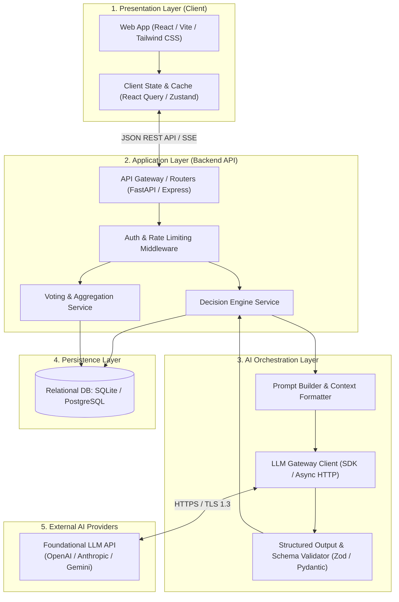
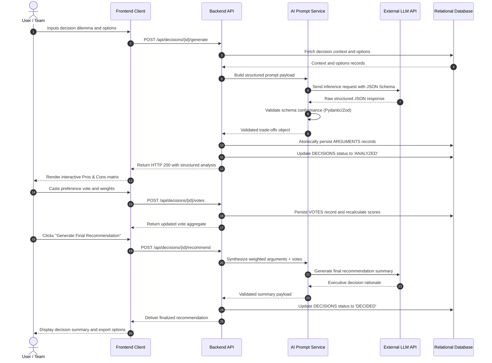

# High-Level Architecture Plan - AI Decision Helper

This document details the architectural blueprint, component design, communication protocols, AI integration pipeline, and data flow for the **AI Decision Helper** platform, planned for execution in an AI-accelerated hackathon sprint.

---

## 1. Architectural Pattern & Overview

AI Decision Helper utilizes a modular, decoupled **3-Tier Web Architecture supplemented by an AI Orchestration Layer**. This design maximizes developer velocity across independent team members during a 24-hour sprint while ensuring clear separation of concerns, testability, and deterministic data handling.

- **Presentation Layer**: Client-side Single Page Application (SPA) built with React, Vite, and Tailwind CSS.
- **Application & API Layer**: High-performance RESTful API service built with FastAPI (Python) or Express (TypeScript), responsible for business validation, session state, and transactional persistence.
- **AI Orchestration Layer**: Structured prompt pipeline utilizing LLM APIs (OpenAI / Claude / Gemini) configured with JSON Schema / Structured Outputs to guarantee deterministic trade-off extraction.
- **Persistence Layer**: Relational database (SQLite for local rapid prototyping, PostgreSQL for production deployment) providing ACID guarantees for decision sessions, options, arguments, and votes.

---

## 2. High-Level Architecture Diagram



---

## 3. Component Breakdown & Responsibilities

### 3.1 Presentation Layer (Bob - Frontend Dev)
- **Input Canvas**: Multi-step wizard to formulate problem statements, contextual constraints, and candidate options.
- **Comparison Matrix**: Side-by-side visual comparison displaying pros (green/positive) and cons (amber/negative) with categorized badges and impact indicators.
- **Interactive Voting Panel**: Fast one-click voting controls, 1–5 confidence star rating, and real-time score calculation.
- **Recommendation View**: Prominently presented executive summary with action items and export triggers (Markdown, PDF).

### 3.2 Application & API Layer (Carol - Backend/API Dev)
- **Endpoints**:
  - `POST /api/decisions`: Create a new decision scenario.
  - `GET /api/decisions`: Retrieve history of decision sessions.
  - `POST /api/decisions/{id}/generate`: Trigger AI generation of pros and cons.
  - `POST /api/decisions/{id}/options`: Add or update candidate options.
  - `POST /api/decisions/{id}/votes`: Cast a vote on an option.
  - `POST /api/decisions/{id}/recommend`: Synthesize final AI recommendation.
  - `GET /api/decisions/{id}/export`: Export formatted report in Markdown or JSON.
- **Validation**: Enforce schema constraints using Pydantic / Zod models before calling internal services or database layers.

### 3.3 AI Prompt & Inference Pipeline (Alice - AI Prompt Strategist)
- **Prompt Strategy**: Few-shot prompt engineering providing clear semantic boundaries between objective facts and opinionated bias.
- **Structured Outputs**: Strict JSON Schema enforcement ensuring the model returns strictly valid JSON containing:
  ```json
  {
    "options": [
      {
        "title": "String",
        "pros": [{"category": "String", "description": "String", "impact": "High"}],
        "cons": [{"category": "String", "description": "String", "impact": "Medium"}]
      }
    ]
  }
  ```
- **Fallback & Resilience**: Automatic retry with exponential backoff and heuristic parsing fallback if output validation fails.

### 3.4 Quality Assurance & Testing Suite (Dave - UI/UX & Testing Lead)
- **Component Tests**: Unit tests with Jest / React Testing Library validating UI state transitions.
- **API Integration Tests**: Pytest / Supertest verifying API endpoints, status codes, and database transactions.
- **AI Output Assertion**: Automated evaluation tests checking that AI responses adhere strictly to the JSON schema and maintain balanced pro/con ratios.

---

## 4. End-to-End Decision Generation Flow



---

## 5. Non-Functional Requirements (NFRs)

| Dimension | Target Specification | Mitigation & Design Choice |
| :--- | :--- | :--- |
| **Response Latency** | UI updates < 100ms; AI generation < 4.0s | Optimistic UI updates, loading skeletons, and potential Server-Sent Events (SSE) streaming for AI synthesis. |
| **Reliability** | 99% success rate during demo | 3-attempt exponential backoff on LLM API calls; local mock mode toggle for offline testing. |
| **Security & Privacy** | OWASP Top 10 compliance | Input sanitization to prevent prompt injection; environment-variable isolation for API keys; CORS restricted to frontend domain. |
| **Data Integrity** | Zero orphaned records | Relational foreign key constraints with `ON DELETE CASCADE` on option and argument relationships. |
| **Deployability** | One-command startup | Containerized with Docker / Docker Compose; zero-config frontend deploy on Vercel, backend on Render / Railway. |

---

## 6. Hackathon Sprint Toolchain Mapping

| Team Member | Role | Assigned Layers | Primary Toolchain |
| :--- | :--- | :--- | :--- |
| **Alice** | AI Prompt Strategist | AI Orchestration Layer | OpenAI / Claude API, LangChain / Promptfoo, Cursor |
| **Bob** | Frontend Dev | Presentation Layer | React, Vite, Tailwind CSS, Lucide Icons |
| **Carol** | Backend/API Dev | Application & Data Layers | Python (FastAPI) / Node.js, SQLite / PostgreSQL, SQLAlchemy / Prisma |
| **Dave** | UI/UX & Testing Lead | Design System & QA Suite | Figma, Jest, Pytest, Playwright, Vercel / Render |
