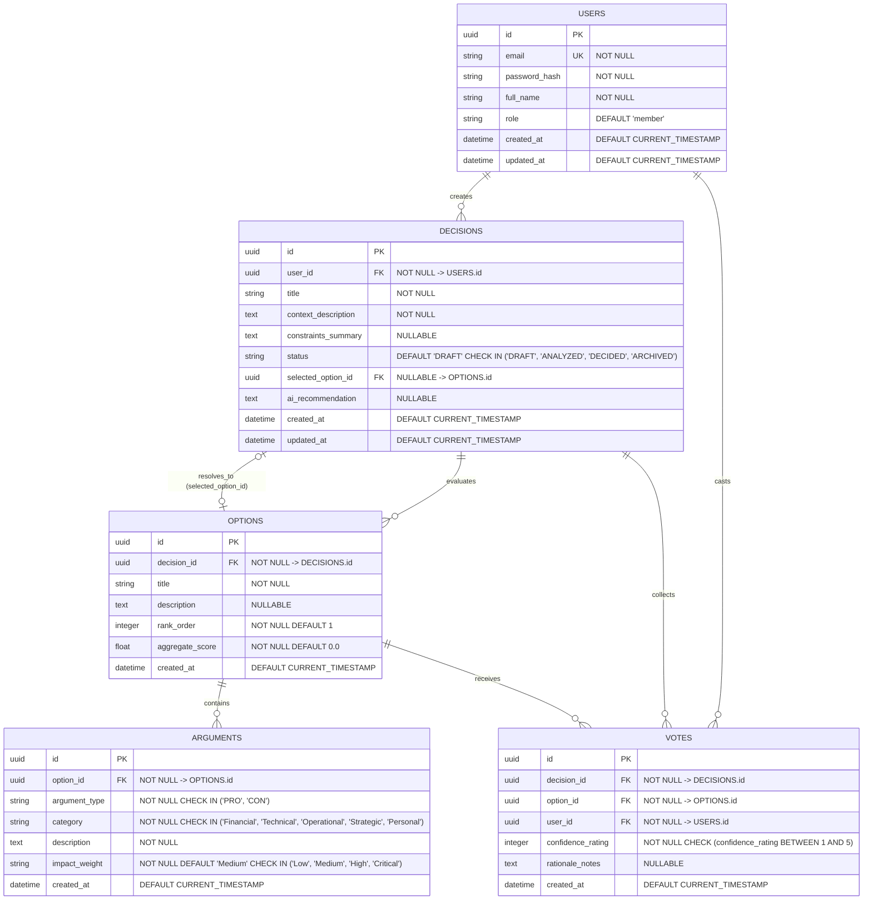

# Data Model Specification - AI Decision Helper

This document defines the relational data model, entity-relationship architecture, data dictionary, integrity constraints, and indexing strategy for the **AI Decision Helper** platform.

---

## 1. Entity-Relationship Diagram (ERD)

---

## 2. Entity Dictionary & Attributes

### 2.1 `USERS`
Represents registered users, decision creators, and team members who review and vote on decisions.

| Attribute | Data Type | Constraints | Description |
| :--- | :--- | :--- | :--- |
| `id` | UUID | Primary Key, Default `gen_random_uuid()` | Unique identifier for the user account. |
| `email` | VARCHAR(255) | Unique, Not Null | Unique email address used for authentication. |
| `password_hash` | VARCHAR(255) | Not Null | Cryptographic hash (bcrypt/Argon2) of user password. |
| `full_name` | VARCHAR(120) | Not Null | Display name of the user. |
| `role` | VARCHAR(30) | Not Null, Default `'member'` | Access control role (`'admin'`, `'member'`, `'guest'`). |
| `created_at` | TIMESTAMPTZ | Not Null, Default `CURRENT_TIMESTAMP` | Timestamp of account creation. |
| `updated_at` | TIMESTAMPTZ | Not Null, Default `CURRENT_TIMESTAMP` | Timestamp of last profile update. |

---

### 2.2 `DECISIONS`
The central aggregate entity representing a decision challenge, dilemma context, constraints, state lifecycle, and finalized AI recommendation.

| Attribute | Data Type | Constraints | Description |
| :--- | :--- | :--- | :--- |
| `id` | UUID | Primary Key, Default `gen_random_uuid()` | Unique identifier for the decision record. |
| `user_id` | UUID | Foreign Key -> `USERS(id)`, Not Null | Identifier of the user who authored the decision. |
| `title` | VARCHAR(200) | Not Null | Clear summary title of the decision dilemma. |
| `context_description` | TEXT | Not Null | In-depth background, motivation, and problem details. |
| `constraints_summary` | TEXT | Nullable | Budget, schedule, compliance, or team constraints. |
| `status` | VARCHAR(20) | Not Null, Default `'DRAFT'` | State enum: `DRAFT`, `ANALYZED`, `DECIDED`, `ARCHIVED`. |
| `selected_option_id` | UUID | Foreign Key -> `OPTIONS(id)`, Nullable | The chosen alternative once a final decision is made. |
| `ai_recommendation` | TEXT | Nullable | Synthesized AI rationale, summary, and action plan. |
| `created_at` | TIMESTAMPTZ | Not Null, Default `CURRENT_TIMESTAMP` | Timestamp when the decision dilemma was logged. |
| `updated_at` | TIMESTAMPTZ | Not Null, Default `CURRENT_TIMESTAMP` | Timestamp of latest modification or state change. |

---

### 2.3 `OPTIONS`
Represents candidate alternatives under comparison for a specific decision.

| Attribute | Data Type | Constraints | Description |
| :--- | :--- | :--- | :--- |
| `id` | UUID | Primary Key, Default `gen_random_uuid()` | Unique identifier for the candidate option. |
| `decision_id` | UUID | Foreign Key -> `DECISIONS(id)`, Not Null | Reference to the parent decision session. |
| `title` | VARCHAR(120) | Not Null | Short title of the alternative (e.g., "Option A: React"). |
| `description` | TEXT | Nullable | Detailed scope and implementation outline of option. |
| `rank_order` | INTEGER | Not Null, Default 1 | Display sequence order on the comparison canvas. |
| `aggregate_score` | FLOAT | Not Null, Default 0.0 | Calculated weighted score derived from pros, cons, and votes. |
| `created_at` | TIMESTAMPTZ | Not Null, Default `CURRENT_TIMESTAMP` | Timestamp of creation. |

---

### 2.4 `ARGUMENTS`
Detailed trade-off points (pros and cons) linked to a specific option, categorized and weighted.

| Attribute | Data Type | Constraints | Description |
| :--- | :--- | :--- | :--- |
| `id` | UUID | Primary Key, Default `gen_random_uuid()` | Unique identifier for the argument point. |
| `option_id` | UUID | Foreign Key -> `OPTIONS(id)`, Not Null | Reference to the option this trade-off evaluates. |
| `argument_type` | VARCHAR(10) | Not Null, Check in `('PRO', 'CON')` | Distinction between positive benefits and drawbacks. |
| `category` | VARCHAR(30) | Not Null | Trade-off category (`Financial`, `Technical`, etc.). |
| `description` | TEXT | Not Null | Full explanation of the specific pro or con. |
| `impact_weight` | VARCHAR(15) | Not Null, Default `'Medium'` | Severity / significance: `Low`, `Medium`, `High`, `Critical`. |
| `created_at` | TIMESTAMPTZ | Not Null, Default `CURRENT_TIMESTAMP` | Timestamp of argument creation. |

---

### 2.5 `VOTES`
Individual team member selections and confidence levels applied to decision options.

| Attribute | Data Type | Constraints | Description |
| :--- | :--- | :--- | :--- |
| `id` | UUID | Primary Key, Default `gen_random_uuid()` | Unique identifier for the vote entry. |
| `decision_id` | UUID | Foreign Key -> `DECISIONS(id)`, Not Null | Reference to the decision session. |
| `option_id` | UUID | Foreign Key -> `OPTIONS(id)`, Not Null | Reference to the option voted for. |
| `user_id` | UUID | Foreign Key -> `USERS(id)`, Not Null | Identifier of the voting team member. |
| `confidence_rating` | INTEGER | Not Null, Check `BETWEEN 1 AND 5` | User confidence rating on a 1–5 scale. |
| `rationale_notes` | TEXT | Nullable | Qualitative comments explaining the vote. |
| `created_at` | TIMESTAMPTZ | Not Null, Default `CURRENT_TIMESTAMP` | Timestamp when the vote was submitted. |

---

## 3. Relational Integrity and Constraints

1. **Cascade Deletes**:
   - Deleting a `DECISION` cascades to delete associated `OPTIONS`, `ARGUMENTS`, and `VOTES`.
   - Deleting an `OPTION` cascades to delete its corresponding `ARGUMENTS` and child `VOTES`.
   - Deleting a `USER` sets foreign key references in `DECISIONS.user_id` to null or prevents deletion if active decisions exist.
2. **Circular Foreign Key Handling**:
   - `DECISIONS.selected_option_id` points to `OPTIONS.id` with `ON DELETE SET NULL` to avoid deadlock during option deletion.
3. **Voting Uniqueness**:
   - Unique composite constraint on `VOTES(decision_id, user_id)` ensures a single user votes once per decision session (or updates their existing vote).

---

## 4. Indexing Strategy

| Index Name | Target Table | Target Columns | Purpose |
| :--- | :--- | :--- | :--- |
| `idx_users_email` | `USERS` | `(email)` | O(1) user lookup during login and registration checks. |
| `idx_decisions_user_id` | `DECISIONS` | `(user_id, created_at DESC)` | High-speed retrieval of user decision history sorted chronologically. |
| `idx_decisions_status` | `DECISIONS` | `(status)` | Filtering decisions by lifecycle state (`DRAFT`, `DECIDED`). |
| `idx_options_decision_id` | `OPTIONS` | `(decision_id, rank_order)` | Rapid rendering of all candidate options for a decision view. |
| `idx_arguments_option_id` | `ARGUMENTS` | `(option_id, argument_type)` | Immediate grouped retrieval of pros and cons by option. |
| `idx_votes_decision_option` | `VOTES` | `(decision_id, option_id)` | Fast aggregation of vote counts and confidence distributions. |
