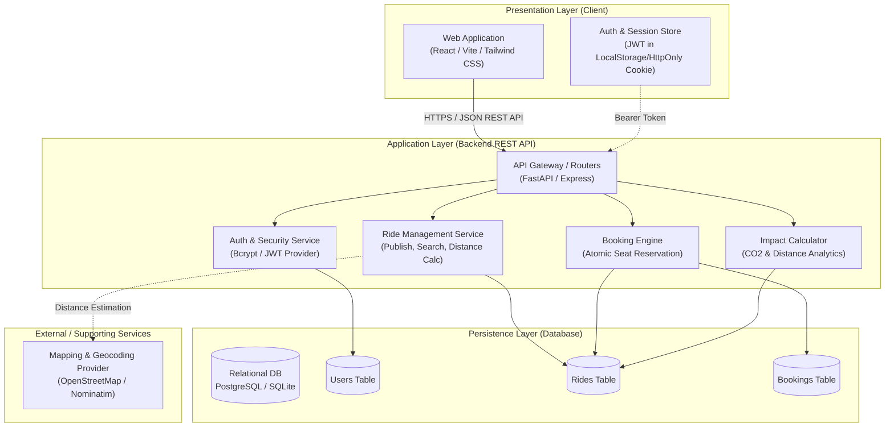
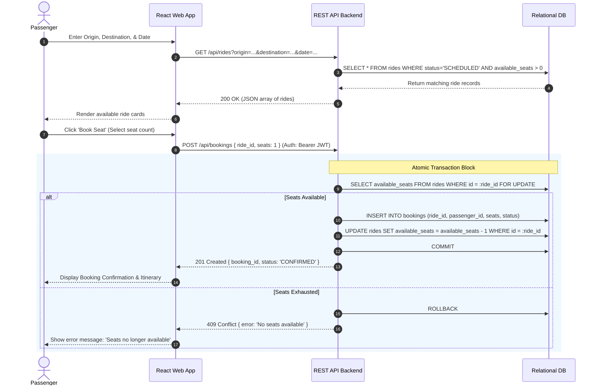

# System Architecture - EcoRide

This document outlines the high-level system architecture, component breakdown, communication protocols, and data flow for the **EcoRide** MVP platform.

---

## 1. Architectural Style & Overview

EcoRide adopts a modern, modular **3-Tier Client-Server Architecture** designed for high developer velocity, clear separation of concerns, and low operational overhead during the lean startup MVP phase.

- **Presentation Tier**: Single-Page Application (SPA) built with React / Next.js and Tailwind CSS, delivering responsive user experiences across mobile and desktop browsers.
- **Application Tier**: Stateless RESTful API backend (FastAPI / Express.js) enforcing business rules, request validation, authentication, and transactional seat allocations.
- **Data Tier**: Relational Database Management System (PostgreSQL / SQLite) ensuring ACID compliance, relational integrity, and foreign key cascading.

---

## 2. High-Level System Diagram

---

## 3. Subsystem Breakdown & Responsibilities

### 3.1 Presentation Layer (Frontend)
- **User Interface Components**: Atomic component structure (Buttons, Cards, Inputs, Modals, Navbar, Alert banners).
- **Views / Pages**:
  - `Landing / Search`: Route search bar, hero section, and platform impact counter.
  - `Ride Listing & Details`: Interactive search results and detailed itinerary view.
  - `Ride Publishing`: Multi-step form for drivers to list upcoming trips with automatic cost-share recommendations.
  - `Dashboard`: Consolidated control center for managing active bookings and published trips.
  - `Authentication`: Login, registration, and session recovery views.
- **Client State & API Client**: Centralized Axios/Fetch HTTP client configured with request interceptors for JWT injection and automated error toasts.

### 3.2 Application Layer (Backend API)
- **Authentication & Authorization**:
  - Role-based access control protecting administrative, driver, and passenger endpoints.
  - Cryptographic password hashing (`bcrypt`) and stateless JWT token issuance with expiry.
- **Ride Management Engine**:
  - Geospatial and waypoint-based string matching for route search queries.
  - Automated distance calculation and statutory carpool cost-share ceiling enforcement.
- **Booking & Concurrency Engine**:
  - Thread-safe, atomic database transactions wrapped in isolation blocks to eliminate race conditions and overbooking.
- **Eco-Impact Analytics Service**:
  - Dynamic CO₂ mitigation algorithm calculating net environmental savings ($0.12\text{ kg CO}_2/\text{km}$ per passenger offset).

### 3.3 Persistence Layer (Database)
- **Schema Management**: Automated database migrations with version control (Alembic / Prisma).
- **Integrity Constraints**: Foreign key relationships with cascade protection, unique constraints on user emails, and check constraints (`available_seats >= 0`).

---

## 4. End-to-End Data Flow: Ride Search & Booking

The sequence below illustrates the end-to-end communication lifecycle for a passenger discovering and reserving a seat:

---

## 5. Security & Reliability Architecture

1. **Authentication & Session Security**:
   - Short-lived JWTs (1 hour expiration) combined with refresh tokens.
   - Passwords salted and hashed with `bcrypt` (work factor 12).
2. **Input Validation & Sanitization**:
   - Strong schema validation on all incoming payload bodies (Pydantic / Zod) to prevent injection and payload corruption.
3. **CORS & Rate Limiting**:
   - Strict CORS policy restricting requests to trusted origin domains.
   - Endpoint rate limiting (e.g., 60 requests/minute per IP) on auth and search routes to prevent abuse.
