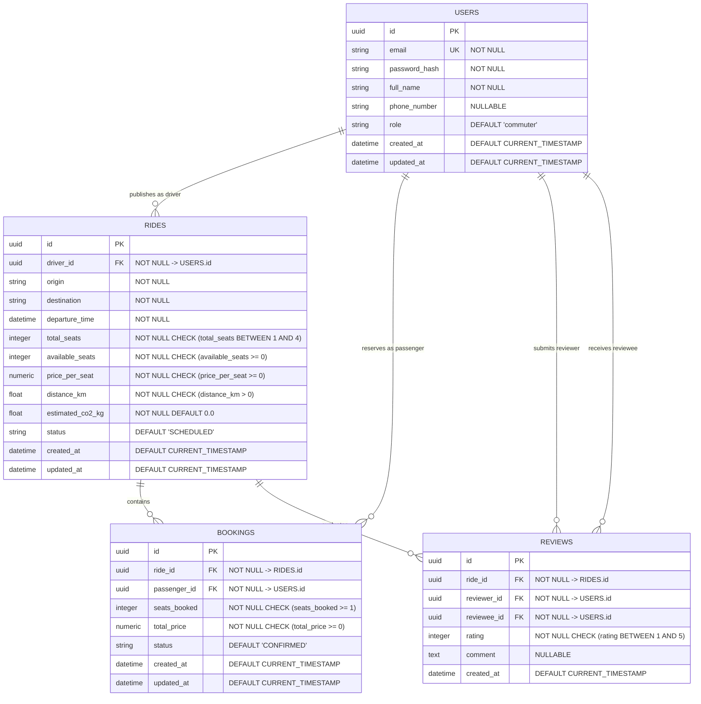

# Data Model Specification - EcoRide

This document defines the relational database schema, entity attributes, integrity constraints, and relationships for the **EcoRide** MVP platform.

---

## 1. Entity-Relationship Diagram (ERD)

---

## 2. Entity Dictionary & Attributes

### 2.1 `users`
Stores user profile, authentication credentials, and system access roles.

| Column | Data Type | Constraints | Description |
| :--- | :--- | :--- | :--- |
| `id` | `UUID` | `PRIMARY KEY`, Default: `gen_random_uuid()` | Unique identifier for the user account |
| `email` | `VARCHAR(255)` | `NOT NULL`, `UNIQUE` | Normalized email address used for login and notifications |
| `password_hash` | `VARCHAR(255)` | `NOT NULL` | One-way cryptographic hash of the user password (bcrypt/Argon2) |
| `full_name` | `VARCHAR(120)` | `NOT NULL` | Display name of the user |
| `phone_number` | `VARCHAR(32)` | `NULLABLE` | Contact telephone number for trip coordination |
| `role` | `VARCHAR(32)` | `NOT NULL`, Default: `'commuter'` | User role: `'commuter'`, `'driver'`, or `'admin'` |
| `created_at` | `TIMESTAMP WITH TIME ZONE` | `NOT NULL`, Default: `NOW()` | Account creation timestamp |
| `updated_at` | `TIMESTAMP WITH TIME ZONE` | `NOT NULL`, Default: `NOW()` | Profile last modification timestamp |

---

### 2.2 `rides`
Represents an itinerary published by a driver with seat availability and schedule.

| Column | Data Type | Constraints | Description |
| :--- | :--- | :--- | :--- |
| `id` | `UUID` | `PRIMARY KEY`, Default: `gen_random_uuid()` | Unique identifier for the trip |
| `driver_id` | `UUID` | `NOT NULL`, `FOREIGN KEY REFERENCES users(id) ON DELETE CASCADE` | References the user offering the ride |
| `origin` | `VARCHAR(255)` | `NOT NULL` | Departure city, landmark, or street address |
| `destination` | `VARCHAR(255)` | `NOT NULL` | Arrival city, campus, or workplace address |
| `departure_time` | `TIMESTAMP WITH TIME ZONE` | `NOT NULL` | Scheduled departure timestamp (must be future date/time) |
| `total_seats` | `SMALLINT` | `NOT NULL`, `CHECK (total_seats BETWEEN 1 AND 4)` | Total passenger seats offered |
| `available_seats` | `SMALLINT` | `NOT NULL`, `CHECK (available_seats >= 0 AND available_seats <= total_seats)` | Current remaining unreserved seats |
| `price_per_seat` | `DECIMAL(8, 2)` | `NOT NULL`, `CHECK (price_per_seat >= 0)` | Cost contribution requested per passenger |
| `distance_km` | `DECIMAL(6, 2)` | `NOT NULL`, `CHECK (distance_km > 0)` | Estimated one-way trip distance |
| `estimated_co2_kg` | `DECIMAL(6, 2)` | `NOT NULL`, Default: `0.0` | Estimated net CO₂ savings based on distance and vehicle occupancy |
| `status` | `VARCHAR(32)` | `NOT NULL`, Default: `'SCHEDULED'` | Lifecycle status: `'SCHEDULED'`, `'IN_PROGRESS'`, `'COMPLETED'`, `'CANCELLED'` |
| `created_at` | `TIMESTAMP WITH TIME ZONE` | `NOT NULL`, Default: `NOW()` | Timestamp when ride was published |
| `updated_at` | `TIMESTAMP WITH TIME ZONE` | `NOT NULL`, Default: `NOW()` | Timestamp when ride details were last updated |

---

### 2.3 `bookings`
Captures passenger seat reservations on scheduled trips.

| Column | Data Type | Constraints | Description |
| :--- | :--- | :--- | :--- |
| `id` | `UUID` | `PRIMARY KEY`, Default: `gen_random_uuid()` | Unique reservation reference code |
| `ride_id` | `UUID` | `NOT NULL`, `FOREIGN KEY REFERENCES rides(id) ON DELETE CASCADE` | Associated ride being booked |
| `passenger_id` | `UUID` | `NOT NULL`, `FOREIGN KEY REFERENCES users(id) ON DELETE CASCADE` | Commuter making the reservation |
| `seats_booked` | `SMALLINT` | `NOT NULL`, `CHECK (seats_booked >= 1)` | Number of seats reserved in this transaction |
| `total_price` | `DECIMAL(8, 2)` | `NOT NULL`, `CHECK (total_price >= 0)` | Calculated total cost (`seats_booked * price_per_seat`) |
| `status` | `VARCHAR(32)` | `NOT NULL`, Default: `'CONFIRMED'` | Reservation state: `'CONFIRMED'`, `'CANCELLED'`, `'COMPLETED'` |
| `created_at` | `TIMESTAMP WITH TIME ZONE` | `NOT NULL`, Default: `NOW()` | Booking submission timestamp |
| `updated_at` | `TIMESTAMP WITH TIME ZONE` | `NOT NULL`, Default: `NOW()` | Booking modification timestamp |

---

### 2.4 `reviews`
Enables two-way post-ride ratings and feedback to foster platform trust.

| Column | Data Type | Constraints | Description |
| :--- | :--- | :--- | :--- |
| `id` | `UUID` | `PRIMARY KEY`, Default: `gen_random_uuid()` | Unique review identifier |
| `ride_id` | `UUID` | `NOT NULL`, `FOREIGN KEY REFERENCES rides(id) ON DELETE CASCADE` | Trip associated with the review |
| `reviewer_id` | `UUID` | `NOT NULL`, `FOREIGN KEY REFERENCES users(id) ON DELETE CASCADE` | User authoring the review |
| `reviewee_id` | `UUID` | `NOT NULL`, `FOREIGN KEY REFERENCES users(id) ON DELETE CASCADE` | User being reviewed (driver or passenger) |
| `rating` | `SMALLINT` | `NOT NULL`, `CHECK (rating BETWEEN 1 AND 5)` | Numerical star rating from 1 to 5 |
| `comment` | `TEXT` | `NULLABLE` | Qualitative review text |
| `created_at` | `TIMESTAMP WITH TIME ZONE` | `NOT NULL`, Default: `NOW()` | Review submission timestamp |

---

## 3. Relational Constraints & Business Rules

1. **Self-Booking Prevention**: A driver cannot book a seat on a ride they own (`passenger_id != rides.driver_id`).
2. **Duplicate Booking Prevention**: A passenger cannot create multiple active bookings for the same ride. A composite unique index on `(ride_id, passenger_id)` where `status = 'CONFIRMED'` enforces this constraint.
3. **Capacity Invariant**: The database enforces `available_seats <= total_seats` and `available_seats >= 0` at all times via table-level `CHECK` constraints.
4. **Referential Integrity**: Deletion of a user cascades to their published rides, bookings, and reviews (`ON DELETE CASCADE`), ensuring no orphaned records exist.
5. **Index Strategy**:
   - `CREATE INDEX idx_rides_search ON rides (origin, destination, departure_time) WHERE status = 'SCHEDULED';`
   - `CREATE INDEX idx_bookings_passenger ON bookings (passenger_id, status);`
   - `CREATE INDEX idx_bookings_ride ON bookings (ride_id, status);`
